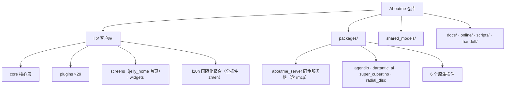

# Aboutme

Aboutme 是一个基于 Flutter 的**跨平台个人助手应用**（Android / iOS / Web / Windows / macOS / Linux），采用插件化架构内置 29 个功能插件（聊天、日记、账单、习惯、AI 对话、Live2D 桌宠、**媒体记录**、**成就系统**、**朋友圈**等），数据本地优先存储，经自建服务器同步（明文）（启动链：首启 onboarding → startup 闸门 → 默认首页果冻小屋 `/jelly_home`）。2026-10 起新增 AI 伙伴拟人化能力：**aliveness 活人感**（延迟回复/分条气泡/记忆/日程/主动消息）与 **moments 朋友圈**（AI 动态流/资产图/自主生图，数据层在 openai 插件、UI 壳独立为 moments 插件）；同期设计系统整体切换为**手绘纸墨风**（skribble 引擎 + TegakiZatsu 手写字体），并落地**全量国际化**（应用层 + core + 29 插件 zh/en 翻译，`lib/l10n/unified_translations.dart` 聚合到 GetX）。

本仓库是 monorepo：除 Flutter 客户端（`lib/`）外，还包含 Dart 同步服务器链路（`packages/aboutme_server` 薄壳 + `packages/aboutme_data_sdk` 纯数据 SDK，已取代 nodejs 服务器）、多个 Dart 子包（agentlib AI 传输库、dartantic_ai 定制 SDK、super_cupertino_navigation_bar、radial_disc_bottom_bar、原生插件等）、共享模型包（`shared_models/`）与专题文档（`docs/`）。技术栈：Flutter/Dart ^3.10 + GetX + flutter_js。

## 约定的规则

- 同步服务器在 `packages/aboutme_server`（Dart，默认端口 **8874**，`procm-command start server` 启动；数据核心在 `packages/aboutme_data_sdk`，客户端 `lib/core/storage/` 也是该 SDK 的转发）。Vue 管理界面源码在 `packages/aboutme_server/admin-vue`，`procm-command start server-admin-build` 构建到同包 `admin/` 由服务器托管于 `/admin/`。旧 nodejs 服务器已于 2026-10-14 彻底移除。
- 新插件必须注册到 `lib/core/builtin_plugins.dart`；JS API 命名 `get{Entity}s` / `create{Entity}` / `update{Entity}` / `delete{Entity}`；推荐 UseCase 分层（接口放 `shared_models/`）。
- 新代码的数据访问统一走 `lib/core/data/aboutme_data_service.dart`（本地/远程自动路由），不要再各自直连 StorageManager。
- Dart 风格：单文件 ≤1000 行、snake_case 文件名、中文注释；`flutter analyze` 为质量门槛，`test/` 现有 34 个测试（活人感/design_system/jelly_live2d/http_storage/media_log/agent 工具调用/moments 地图等），改动相关逻辑后跑 `flutter test`。
- ⚠️ `lib/plugins/openai/aliveness/services/aliveness_store.dart` 与 `test/aliveness_e2e_test.dart` 存在硬编码 API Key，开源/分发前必须移除。
- `tree-shake-icons: false` 是硬性要求（动态 IconData）；Web 平台部分库走条件导入存根。
- `build/`、`dist/`、`.dart_tool/`、`Aboutme.ipa` 为生成物，不要编辑；Agent 不主动执行 git 操作。
- 完整命令（构建/测试/发布）与环境变量说明见 [开发约定](claude/conventions.md)。

## 文件索引

| 文件 | 用途 | 何时阅读 |
|------|------|----------|
| [架构总览](claude/overview.md) | 仓库形态、运行时拓扑、设计取舍 | 第一次接手项目 |
| [开发约定](claude/conventions.md) | 命令、代码风格、插件规范、环境变量 | 写代码之前 |
| [模块职责](claude/module-responsibilities.md) | 全部模块/插件的职责速查 | 定位功能归属 |
| [入口与启动](claude/entrypoints.md) | main.dart 启动链、各服务入口、CI | 排查启动问题、加初始化逻辑 |
| [对外接口](claude/public-interfaces.md) | 路由、JS Bridge、REST/WS、MCP 工具、转发协议 | 对接或扩展接口 |
| [依赖与配置](claude/dependencies-and-config.md) | 依赖分组、路径依赖、配置文件清单 | 升级依赖、改配置 |
| [数据模型](claude/data-model.md) | 本地存储、shared_models、同步协议、服务端存储 | 改数据结构、做同步 |
| [测试与质量](claude/testing-and-quality.md) | 测试现状、质量工具与风险 | 提测、补测试 |
| [文件地图](claude/file-map.md) | 目录速查表（含 docs/ 主题分类） | 找文件 |
| [常见问题](claude/faq.md) | 高频问题与定位路径 | 遇到问题先查这里 |
| [索引变更记录](claude/changelog.md) | 本文档体系的更新历史 | 重复运行 /init-project 时 |

## 模块索引

| 模块 | 职责摘要 | 文档 |
|------|----------|------|
| `lib/` | Flutter 应用代码（core / plugins×29 / screens / widgets / design_system，约 1981 个 Dart 文件） | [lib/CLAUDE.md](lib/CLAUDE.md) |
| `lib/plugins/` | 插件层聚合索引：插件体系架构 + 29 插件职责/路由/约定 | [lib/plugins/CLAUDE.md](lib/plugins/CLAUDE.md) |
| `lib/plugins/chat` | 频道式聊天/消息记录（含 @AI 事件桥、贴图系统、AI 追问线程） | [lib/plugins/chat/CLAUDE.md](lib/plugins/chat/CLAUDE.md) |
| `lib/plugins/agent_chat` | 一对一 AI 对话：三阶段工具调用/Agent 链/语音通话 + dartantic 原生 function-calling | [lib/plugins/agent_chat/CLAUDE.md](lib/plugins/agent_chat/CLAUDE.md) |
| `lib/plugins/openai` | AI 中枢（112 文件）：服务商/Agent/预设 + **aliveness 活人感** + **moments 数据层**（UI 壳在 moments 插件）+ soul_forge 内置人格师 | [lib/plugins/openai/CLAUDE.md](lib/plugins/openai/CLAUDE.md) |
| `lib/plugins/moments` | **朋友圈 UI 壳插件**（2026-10 独立）：动态流/回忆/个人主页三页签 + 投稿面板 + 手绘贴纸 | [lib/plugins/moments/CLAUDE.md](lib/plugins/moments/CLAUDE.md) |
| `lib/plugins/live2d` | Live2D 桌宠：存档管理 + TTS 播报（渲染在 jelly_home） | [lib/plugins/live2d/CLAUDE.md](lib/plugins/live2d/CLAUDE.md) |
| `lib/plugins/media_log` | 媒体记录：阅读 + 观影记录（瀑布流封面网格，2026-10 新增） | [lib/plugins/media_log/CLAUDE.md](lib/plugins/media_log/CLAUDE.md) |
| `lib/plugins/achievement` | 成就系统：定义/统计/解锁弹窗/桌面小组件（2026-10 新增） | [lib/plugins/achievement/CLAUDE.md](lib/plugins/achievement/CLAUDE.md) |
| `lib/l10n` | 国际化聚合层：unified_translations 汇入应用层 + core + 29 插件的 zh/en 翻译 | 未深扫（见 [lib/CLAUDE.md](lib/CLAUDE.md)） |
| `lib/screens/jelly_home` | 果冻小屋主页（**应用默认主页**，四页签 + Live2D 渲染核心 + 状态面板） | [lib/screens/jelly_home/CLAUDE.md](lib/screens/jelly_home/CLAUDE.md) |
| `packages/` | 13 个子包聚合索引（数据 SDK + Dart 服务器 + 4 Dart 库 + 1 vendor 库 + 6 原生插件） | [packages/CLAUDE.md](packages/CLAUDE.md) |
| `packages/aboutme_data_sdk` | 纯数据 SDK：存储接口/HTTP 远端存储/服务端文件存储/认证/插件数据（客户端与服务器共用） | [packages/aboutme_data_sdk/README.md](packages/aboutme_data_sdk/README.md) |
| `packages/aboutme_server` | 同步服务器（Dart，REST + WS 实时同步 + 插件 API + MCP /mcp + FCM + 管理界面托管，含 admin-vue 前端源码） | [packages/aboutme_server/README.md](packages/aboutme_server/README.md) |
| `packages/agentlib` | OpenAI 兼容 HTTP/SSE 传输门面（openai/agent_chat 消费） | [packages/agentlib/CLAUDE.md](packages/agentlib/CLAUDE.md) |
| `packages/dartantic_ai` | 上游 dartantic_ai 3.4.2 vendor 镜像（3 处定制），agent_chat 原生工具调用消费 | [packages/dartantic_ai/CLAUDE.md](packages/dartantic_ai/CLAUDE.md) |
| `shared_models/` | 客户端/服务端共享模型（Repository / UseCase / 同步协议） | [shared_models/CLAUDE.md](shared_models/CLAUDE.md) |
| `scripts/` | 多平台构建与发布脚本 | [scripts/CLAUDE.md](scripts/CLAUDE.md) |
| `online/` | WebView 小程序仓库（4 应用）、在线脚本与 Agent 配置 | [online/CLAUDE.md](online/CLAUDE.md) |
| `docs/` | 70 篇专题文档（小组件/快捷方式/计时器/成就系统/原生插件实现等） | 未扫描（主题分类见 [文件地图](claude/file-map.md)） |

## 扫描状态

- 更新时间：2026-10-20（第七轮：moments 独立成插件并建档，28→29；确认全量国际化体系——29 插件 + core + 应用层均有 l10n/；测试 17→34；lib Dart 1881→1981；新依赖 flutter_map/graphview；material_emoji_picker 包短暂引入后已删除、emoji_picker 组件已迁入 lib/widgets）。
- 已扫描：10-14 以来 179 个提交的模块级 diff 归类、builtin_plugins 29 插件逐一核对、moments 插件 13 文件与 moments_js_api 全量、openai/moments 数据层归属、l10n/unified_translations 聚合结构、29 插件 Dart 文件数全量重统计、test/ 清单（34 个）、pubspec 依赖 diff。
- 跳过：`build/`、`dist/`、`node_modules/`、`.git/`、平台宿主工程内部（android/ios/macos/linux/windows/web）、assets 二进制、docs/ 正文、179 个提交逐个的语义细节（信息均为 "fix"）。
- 未深扫（下次增量优先）：l10n key 全量清单与 arb 生成链路、lib/screens 与 lib/widgets 的 302+188 文件级 UI 变更语义（手绘化重构细节）、assets/svg 120 个新增图标清单、design_system 51 文件建档、22 个旧版插件 CLAUDE.md 向新格式迁移、aboutme_data_sdk 与 aboutme_server 源码细节。
- 详细覆盖度量与续跑建议见 [索引变更记录](claude/changelog.md)。
