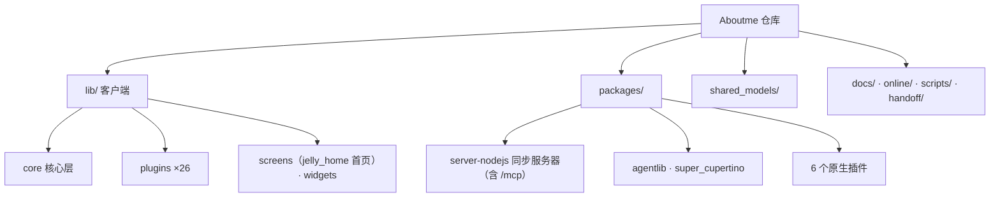

# Aboutme

Aboutme 是一个基于 Flutter 的**跨平台个人助手应用**（Android / iOS / Web / Windows / macOS / Linux），采用插件化架构内置 26 个功能插件（聊天、日记、账单、习惯、AI 对话、Live2D 桌宠等），数据本地优先存储，经自建服务器做端到端加密同步（默认首页为果冻小屋 `/jelly_home`）。2026-10 起新增 AI 伙伴拟人化能力：**aliveness 活人感**（延迟回复/分条气泡/记忆/日程/主动消息）与 **moments 朋友圈**（AI 动态流/资产图/自主生图），均在 openai 插件内。

本仓库是 monorepo：除 Flutter 客户端（`lib/`，1868 个 Dart 文件）外，还包含 1 个 Node.js 同步服务器、9 个 Dart 子包（agentlib AI 传输库、dartantic_ai 定制 SDK、super_cupertino_navigation_bar、6 个原生插件）、共享模型包（`shared_models/`）与 67 篇专题文档（`docs/`）。技术栈：Flutter/Dart ^3.10 + GetX + flutter_js，Node ≥ 18（Express、MCP SDK）。

## 约定的规则

- 同步服务器在 `packages/server-nodejs`（默认端口 **8874**）；旧文档中 `cd server && dart run ...`、`api_forwarding_server`、独立 mcp-aboutme-server、WebDAV 同步均已失效/删除，勿再引用。
- 新插件必须注册到 `lib/core/builtin_plugins.dart`；JS API 命名 `get{Entity}s` / `create{Entity}` / `update{Entity}` / `delete{Entity}`；推荐 UseCase 分层（接口放 `shared_models/`）。
- Dart 风格：单文件 ≤1000 行、snake_case 文件名、中文注释；`flutter analyze` 为质量门槛，`test/` 现有 8 个测试（活人感/design_system/http_storage/live2d/agent_chat），改动相关逻辑后跑 `flutter test`。
- ⚠️ `lib/plugins/openai/aliveness/services/aliveness_store.dart` 与 `test/aliveness_e2e_test.dart` 存在硬编码 API Key，开源/分发前必须移除。
- `tree-shake-icons: false` 是硬性要求（动态 IconData）；Web 平台部分库走条件导入存根。
- `build/`、`dist/`、`.dart_tool/`、`Aboutme.ipa` 为生成物，不要编辑；Agent 不主动执行 git 操作。
- 完整命令（构建/测试/发布）与环境变量说明见 [开发约定](claude/conventions.md)。

## 文件索引

| 文件 | 用途 | 何时阅读 |
|------|------|----------|
| [架构总览](claude/overview.md) | 仓库形态、运行时拓扑、设计取舍 | 第一次接手项目 |
| [开发约定](claude/conventions.md) | 命令、代码风格、插件规范、环境变量 | 写代码之前 |
| [模块职责](claude/module-responsibilities.md) | 全部模块/插件的职责速查 | 定位功能归属 |
| [入口与启动](claude/entrypoints.md) | main.dart 启动链、各服务入口、CI | 排查启动问题、加初始化逻辑 |
| [对外接口](claude/public-interfaces.md) | 路由、JS Bridge、REST/WS、MCP 工具、转发协议 | 对接或扩展接口 |
| [依赖与配置](claude/dependencies-and-config.md) | 依赖分组、路径依赖、配置文件清单 | 升级依赖、改配置 |
| [数据模型](claude/data-model.md) | 本地存储、shared_models、同步协议、服务端存储 | 改数据结构、做同步 |
| [测试与质量](claude/testing-and-quality.md) | 测试现状、质量工具与风险 | 提测、补测试 |
| [文件地图](claude/file-map.md) | 目录速查表（含 docs/ 主题分类） | 找文件 |
| [常见问题](claude/faq.md) | 高频问题与定位路径 | 遇到问题先查这里 |
| [索引变更记录](claude/changelog.md) | 本文档体系的更新历史 | 重复运行 /init-project 时 |

## 模块索引

| 模块 | 职责摘要 | 文档 |
|------|----------|------|
| `lib/` | Flutter 应用代码（core / plugins×26 / screens / widgets，1868 个 Dart 文件） | [lib/CLAUDE.md](lib/CLAUDE.md) |
| `lib/plugins/` | 插件层聚合索引：插件体系架构 + 26 插件职责/路由/约定 | [lib/plugins/CLAUDE.md](lib/plugins/CLAUDE.md) |
| `lib/plugins/chat` | 频道式聊天/消息记录（109 文件，含 @AI 事件桥） | [lib/plugins/chat/CLAUDE.md](lib/plugins/chat/CLAUDE.md) |
| `lib/plugins/agent_chat` | 一对一 AI 对话：三阶段工具调用/Agent 链/语音通话 | [lib/plugins/agent_chat/CLAUDE.md](lib/plugins/agent_chat/CLAUDE.md) |
| `lib/plugins/openai` | AI 中枢（104 文件）：服务商/Agent/预设 + **aliveness 活人感** + **moments 朋友圈** | [lib/plugins/openai/CLAUDE.md](lib/plugins/openai/CLAUDE.md) |
| `lib/plugins/live2d` | Live2D 桌宠：存档管理 + TTS 播报（渲染在 jelly_home） | [lib/plugins/live2d/CLAUDE.md](lib/plugins/live2d/CLAUDE.md) |
| `lib/screens/jelly_home` | 果冻小屋主页（**应用默认启动页**，四页签 + Live2D 渲染核心） | [lib/screens/jelly_home/CLAUDE.md](lib/screens/jelly_home/CLAUDE.md) |
| `packages/` | 10 个子包聚合索引（1 个 Node 服务 + 3 个 Dart 库 + 6 个原生插件） | [packages/CLAUDE.md](packages/CLAUDE.md) |
| `packages/server-nodejs` | 同步服务器（REST + WS 实时同步 + 管理面板 + 服务端插件系统 + MCP 端点 /mcp） | [packages/server-nodejs/CLAUDE.md](packages/server-nodejs/CLAUDE.md) |
| `packages/agentlib` | OpenAI 兼容 HTTP/SSE 传输门面（openai/agent_chat 消费） | [packages/agentlib/CLAUDE.md](packages/agentlib/CLAUDE.md) |
| `shared_models/` | 客户端/服务端共享模型（Repository / UseCase / 同步协议） | [shared_models/CLAUDE.md](shared_models/CLAUDE.md) |
| `scripts/` | 多平台构建与发布脚本 | [scripts/CLAUDE.md](scripts/CLAUDE.md) |
| `online/` | WebView 小程序仓库（4 应用）、在线脚本与 Agent 配置 | [online/CLAUDE.md](online/CLAUDE.md) |
| `docs/` | 67 篇专题文档（小组件/快捷方式/计时器/原生插件实现等） | 未扫描（主题分类见 [文件地图](claude/file-map.md)） |

## 扫描状态

- 更新时间：2026-10-05（第五轮：补扫上轮全部遗留——live2d/jelly_home/form_fields/agentlib 深扫建档；openai 重写并记录 10 月新增的 aliveness/moments 子系统；server-nodejs 9-15 WS 与自预热变更核实；git 9-14 以来 22 个提交的文件级 diff 复核）
- 已扫描：前四轮全部范围 + 本轮 openai 全量（104 文件含两个新子系统逐个）、live2d 全部 9 文件、jelly_home 全部 17 文件、form_fields 50 文件清单与消费方、agentlib 全量、server-nodejs 变更 diff、test/ 清单（8 个）。
- 跳过：`build/`、`dist/`、`node_modules/`、`.git/`、平台宿主工程内部（android/ios/macos/linux/windows/web）、assets 二进制。
- 未深扫（下次增量优先）：`docs/` 67 篇正文、22 个旧版插件 CLAUDE.md 向新格式迁移、jelly_live2d.dart 渲染内部（1180 行）、openai 市场(soul_forge)/controllers 细节、5 个原生插件的平台代码。
- 详细覆盖度量与续跑建议见 [索引变更记录](claude/changelog.md)。
