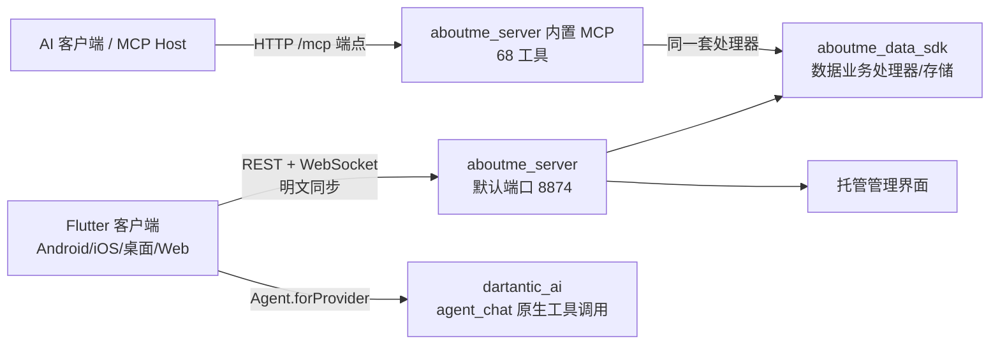

# 架构总览

> 所属：仓库根目录 · [返回索引](../CLAUDE.md)

## 仓库形态

Aboutme 是一个**单仓多模块（monorepo）**项目，由四类角色组成：

1. **Flutter 客户端**（`lib/`，约 1981 个 Dart 文件）：跨平台个人助手应用本体，插件化架构，29 个内置功能插件（2026-10-20 moments 朋友圈独立成插件），默认首页为果冻小屋（`/jelly_home`，首启先经 `/onboarding` → `/startup` 启动闸门）。
2. **本地/自建子包**（`packages/`，12 个子包）：同步服务器链路（`aboutme_data_sdk` 纯数据 SDK + `aboutme_server` Dart 薄壳服务器，取代已删除的 `server-nodejs`）、4 个 Dart UI/传输库（agentlib、dartantic_ai vendor 镜像、super_cupertino_navigation_bar、radial_disc_bottom_bar）与 6 个原生插件（悬浮球、前台服务、通知、Intent、NFC、桌面小组件）。
3. **共享模型**（`shared_models/`）：客户端与服务端共用的 Dart 包（Repository 接口、UseCase、DTO、同步协议模型）。
4. **周边资源**：`docs/`（70 篇专题文档）、`online/`（WebView 小程序仓库）、`scripts/`（构建发布脚本）、`plan/`（PRD 与执行方案）、`tool_templates/`（插件工具模板）、`handoff/`（会话交接底稿）、`.github/workflows/`（5 个平台构建 CI）。

## 运行时拓扑

> 历史：`packages/api_forwarding_server` 与 `packages/mcp-aboutme-server` 已删除；Node 服务器 `server-nodejs` 于 2026-10-11 被 aboutme_server 取代、**2026-10-14 彻底删除**；客户端/服务端加密（AES-256-GCM）已随数据 SDK 化移除，现为**明文**同步（见 `handoff/2026-10-11_data-sdk-server-unification.md`）。

## 关键设计取舍

- **数据 SDK 化（2026-10-11 起）**：数据业务统一收口 `packages/aboutme_data_sdk`，客户端、服务器 REST、MCP 共用同一套插件处理器；客户端新代码经 `lib/core/data/aboutme_data_service.dart` 统一本地/远程分流，不再各自走 StorageManager；数据明文存于统一数据区。
- **本地优先**：数据以 JSON 文件形式存于本地（Web 端为 IndexedDB），服务器只做同步与中转（纯文件存储，无数据库）。
- **插件化**：功能以 `PluginBase` 子类为单位（`lib/plugins/*`），在 `lib/core/builtin_plugins.dart` 静态注册（29 个）；插件可向 JS Bridge 暴露 API、注册路由与数据选择器。全部插件 + core + 应用层自带 zh/en 翻译，经 `lib/l10n/unified_translations.dart` 聚合到 GetX。
- **手绘纸墨风设计系统（2026-10）**：`lib/design_system/` 从"软糖果冻风"整体切换为 skribble 手绘引擎（固定 seed、色板 × 墨线档位主题预设，取代旧"主题颜色/Ink style"双开关）；全局字体 TegakiZatsu（851 手写杂书体）。
- **双入口 AI 集成**：应用内 AI（`openai`/`agent_chat` 插件；agent_chat 原生 function-calling 走本地 `dartantic_ai`，HTTP/SSE 门面收敛到 `agentlib`）与外部 AI 工具（aboutme_server MCP 端点）并存。
- **JS 扩展生态**：内置 `flutter_js` 引擎 + `scripts_center` 插件 + `online/` 小程序仓库，形成应用内脚本/小程序生态。

## 版本与平台

- 应用版本：`0.0.1`（见 `pubspec.yaml`，`publish_to: none`）
- Dart SDK `^3.10.0`
- 目标平台：Android、iOS、Web、Windows、macOS、Linux（日语本地化已移除，现中/英双语）
