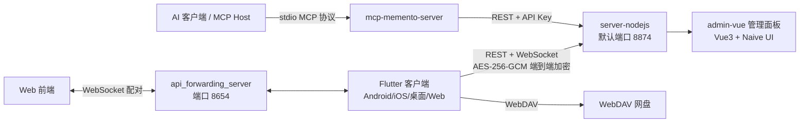

# 架构总览

> 所属：仓库根目录 · [返回索引](../CLAUDE.md)

## 仓库形态

Memento 是一个**单仓多模块（monorepo）**项目，由四类角色组成：

1. **Flutter 客户端**（`lib/`，约 1900+ Dart 文件）：跨平台个人助手应用本体，插件化架构，25 个内置功能插件。
2. **本地/自建子包**（`packages/`，9 个子包）：6 个 Flutter 原生插件（悬浮球、前台服务、通知、Intent、NFC、桌面小组件）+ 3 个 Node.js/TypeScript 服务。
3. **共享模型**（`shared_models/`）：客户端与服务端共用的 Dart 包（Repository 接口、UseCase、DTO、同步协议模型）。
4. **周边资源**：`docs/`（71 篇专题文档）、`online/`（WebView 小程序仓库）、`scripts/`（构建发布脚本）、`tool_templates/`（插件工具模板）、`.github/workflows/`（5 个平台构建 CI）。

## 运行时拓扑

## 关键设计取舍

- **本地优先**：数据以 JSON 文件形式存于本地（Web 端为 IndexedDB），服务器只是同步与中转通道，无数据库依赖（服务端同为纯文件存储）。
- **插件化**：功能以 `PluginBase` 子类为单位（`lib/plugins/*`），在 `lib/core/builtin_plugins.dart` 静态注册；插件可向 JS Bridge 暴露 API、注册路由与数据选择器。
- **端到端加密同步**：客户端 `encrypt`（AES-256-GCM）与服务端 `encryptionService.ts` 对应；同时保留 WebDAV 作为备选同步通道。
- **双入口 AI 集成**：应用内 AI（`openai`/`agent_chat` 插件）与外部 AI 工具（MCP 服务器，60+ 工具，12 个插件域）并存。
- **JS 扩展生态**：内置 `flutter_js` 引擎 + `scripts_center` 插件 + `online/` 小程序仓库，形成应用内脚本/小程序生态。

## 版本与平台

- 应用版本：`2.1.3+160323`（见 `pubspec.yaml`）
- Dart SDK `^3.7.0`；Node.js `>= 18`（所有 Node 子包）
- 目标平台：Android、iOS、Web、Windows、macOS、Linux
- 国际化：中文（zh_CN）、英文（en_US）、日文（ja_JP）
