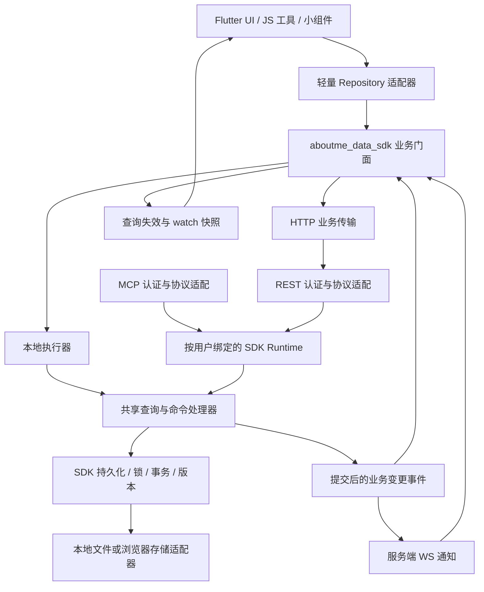

# Aboutme 统一业务数据访问改造计划

日期：2026-10-23。状态：代码审查后的实施建议，尚未实施本计划。

## 1. 改造结论与边界

问题根源是“业务更新仍由客户端读 JSON、修改内存、再覆盖 JSON”，而不是缺少一个 HTTP 存储实现。仅替换文件存储后端、增加重新加载或继续修补 WebSocket 防抖，都不能消除多端覆盖、陈旧内存和模型不一致。

目标统一为：

1. 客户端、服务端业务层只能调用 `aboutme_data_sdk` 的业务查询和命令。
2. 客户端只在初始化时指定 local/http；插件不判断模式、不拼 HTTP、不拼业务文件路径。
3. SDK 在本地模式执行共享业务处理器，在 HTTP 模式发送业务方法及参数；服务端调用相同处理器。
4. 服务端根据最新持久化状态完成变更，客户端不得上传整个频道列表、消息文件、账本等作为普通更新。
5. 业务查询、缓存、版本与变更订阅由 SDK 统一管理。页面内存是展示快照，不是 HTTP 模式的数据真相。
6. 文件系统读写收敛到 SDK 的持久化/平台适配层；服务端路由、Flutter 插件、Repository 不直接访问系统文件。

本计划中的“禁止直接读写系统文件”包括用户业务 JSON、附件、插件脚本和持久化设置。SDK 内部最终仍必须访问磁盘或浏览器持久化。系统选择文件、拍照、播放媒体等由宿主调用系统能力，但数据的导入、保存、读取和临时物化通过 SDK 暴露的方法完成。运行时资源、系统凭据与临时缓存也需要明确的 SDK 适配接口，不能成为任意访问业务目录的口子。

优先保留现有 JSON 数据布局及 REST/MCP 基础，不要求先迁移数据库，也不重写 UI。

## 2. 已核实的代码现状

### 2.1 已有基础，可以复用

| 代码位置 | 当前能力 | 处理建议 |
| --- | --- | --- |
| `packages/aboutme_data_sdk/lib/src/services/aboutme_data.dart` | local/remote 工厂，业务 `call/get` 与文件接口并存 | 保留业务门面，逐步撤出应用可用的文件接口 |
| `packages/aboutme_data_sdk/lib/src/services/invoker.dart` | 根据路由调用共享 handler | 作为统一执行入口，补验证、事务、版本和命令上下文 |
| `packages/aboutme_data_sdk/lib/src/services/handlers/` | 已有 12 类插件的业务处理器 | 按客户端真实功能补齐，不把现有能力等同于完整覆盖 |
| `packages/aboutme_server/lib/src/plugin_routes.dart` | REST 调用 SDK handler | 路由保留认证、参数解码、响应编码职责 |
| `packages/aboutme_server/lib/src/mcp/` | MCP 也经 `PluginInvoker` 调用 handler | 保持共用业务规则，减少手工方法映射 |
| `shared_models/lib/repositories/`、`usecases/` | 无 Flutter 依赖的 DTO、Repository 与用例 | 作为协议类型与兼容接口的基础，避免再建第三套模型 |
| `packages/aboutme_data_sdk/lib/src/local_file_storage.dart` | 原始文件路径约束、部分单文件锁与条件写 | 复用底层能力；不能把单文件锁视为业务事务 |

### 2.2 静态盘点基线

对当前工作区 Dart 源码按调用语法扫描，结果如下。数字是候选调用次数，不是已确认的违规数量；包含媒体展示、临时文件和网络流等误匹配。统计还不覆盖别名、动态调用、原生代码与所有旧 StorageManager 方法，实施第一阶段要生成精确清单。

| 范围 | 文件级接口调用候选 | 直接 IO 候选 |
| --- | --- | --- |
| `lib/plugins` | 398 处，73 个文件 | 174 处，77 个文件 |
| `lib/core` | 17 处，3 个文件 | 59 处，11 个文件 |
| `packages/aboutme_server/lib` | 本扫描表达式未匹配到 | 17 处，6 个文件 |

在插件目录未匹配到直接调用 `AboutmeDataService.instance.call/get` 的写法；不能据此断言没有任何间接业务调用，但可确认现有迁移主要停留在文件层。

SDK `route_config.dart` 当前只列出：chat、notes、activity、goods、bill、todo、diary、checkin、calendar、contact、tracker、day。`handler_factory.dart` 对其它名称返回通用 CRUD，并不表示这些插件已有路由或正确的数据模型。

### 2.3 必须优先处理的具体缺口

1. **HTTP 业务调用目前没有保留全部 HTTP method。** `AboutmeData.call` 能解析 GET/PUT/DELETE 等，但非 GET 一律转入 `RemotePluginBackend.call`，后者固定使用 `postJson`。直接把所有客户端调用替换成 `call()`，会让更新和删除命中错误路由。必须先补完整 method 分发。
2. **客户端 Repository 仍是内存适配器。** 例如 `ClientChatRepository.getChannels/getChannelById` 读取 `dataService.channels`；其 `updateChannel` 还只更新颜色。接口名相同不代表语义完整。
3. **服务端业务写入也存在竞争。** `LocalPluginBackend.write` 直接 `writeAsString`；多个 REST/MCP 请求各建 backend，handler 的读—改—写没有统一事务。改成业务 API 后仍可能并发丢消息。
4. **多文件更新提前发事件。** backend 每次文件写入就 `notifyChanged`；频道详情、消息、索引可能尚未全部完成，客户端已经开始重载。
5. **原始文件条件写会回退强写。** `HttpStorage._writeBytesConditional` 在冲突后刷新版本重试，进一步冲突调用 `_forceWrite`。旧客户端全量 JSON 写入可能覆盖新数据，迁移期必须限制。
6. **存在静默切换数据源。** `StorageManager.initialize` 与 `AboutmeDataService.initialize` 都有远端不可用回退本地的逻辑。用户可能在不知情时向另一份数据写入。
7. **客户端与 MCP 数据模型不同。** 已出现消息 `date/user` 与 `createdAt/senderId/senderName` 不一致；频道 `title/name`、日记日期序列化、富文本格式也需逐项核对。
8. **刷新职责分散。** WebSocket → `AboutmeDataService` 事件流与 `RouteRefreshManager` 两路传播；插件、页面、控制器分别持有缓存。订阅定时器又按 pluginId 共用，多个订阅者可能互相覆盖/取消。
9. **本地 Web 后端缺口。** SDK 的 `LocalPluginBackend` 依赖 `dart:io`，Web 使用 stub；客户端另有 `web_storage.dart` 的 IndexedDB 文件适配。新接口必须支持浏览器本地模式，不能只覆盖桌面和服务器。
10. **服务端仍有 SDK 外的持久化。** `system_routes.dart` 直接读插件注册表、写商店配置；`fcm_service.dart` 直接读服务账号文件。静态资源读取与业务配置读取应分别迁移到明确的 SDK 能力。
11. **旧设计文档已不适合作为目标。** `docs/http_storage_backend_plan.md` 包含旧 Node 服务与“远端文件 CRUD”方案，且部分加密描述与当前明文 SDK 实现不同；新计划完成后应标注旧文档为历史方案。

## 3. 目标架构



服务端也通过 SDK，但不把请求再次发回自己的 HTTP API。REST/MCP 取得已认证用户后，获取绑定该用户的本地 SDK Runtime；两种协议共享同一个 runtime 所依赖的锁、事务和版本服务。

依赖方向：Flutter/Server → SDK → shared_models。`shared_models` 不反向依赖 SDK，不含 Flutter 类型；界面中的 Color/IconData 等由客户端适配。

## 4. SDK 对外接口与初始化

以下为拟议接口，名称需在第一阶段与现有类型对齐，不是已经实现的 API。

```dart
final data = await AboutmeData.open(
  DataConfig.local(storage: localPersistenceAdapter),
);
// 或
final data = await AboutmeData.open(
  DataConfig.http(serverUrl: url, credentialProvider: credentials),
);

final page = await data.chat.listMessages(
  channelId: id,
  query: MessageQuery(limit: 50),
);
final result = await data.chat.sendMessage(
  SendMessage(channelId: id, content: text, clientMutationId: mutationId),
);
final subscription = data.chat.watchMessages(channelId: id).listen(render);
```

约束：

- `AboutmeDataService` 只管理宿主生命周期、配置和对 SDK 的引用；不再决定存储路径、缓存策略和事件防抖。
- typed facade 内部复用动作定义与共享执行器；过渡期可保留字符串 `call`，但不能另写一套业务逻辑。
- 每个动作定义 actionId、HTTP method/path、请求/响应模型、权限、影响资源和能力版本。REST/MCP/SDK 依据同一份定义适配，先做一致性测试，确有重复维护成本后再引入代码生成。
- HTTP 传输正确支持 GET/POST/PUT/PATCH/DELETE，明确 DELETE 参数放置、路径参数编码、null、列表和日期的编码规则。
- HTTP 非成功状态先映射统一错误，不能只看响应是否为 JSON Map。避免错误处理中的截断字符串越界覆盖原始错误。
- 字段更新传具体变更项，明确“字段未传”和“显式清空为 null”的区别；不上传陈旧完整实体覆盖其它字段。
- SDK 返回已提交的实体或变更结果；UI 使用返回值更新展示，不自行伪造服务端时间、版本、余额或索引。
- 初始化显式返回模式、连接状态、当前用户和能力列表。HTTP 离线时不自动改为 local，允许保留只读旧快照并标明陈旧。
- 切换后端/账号必须等待或终止在途请求、取消订阅、清缓存，再创建新实例；缓存键包含数据源身份和用户。
- 附件使用 `assets.upload/read/materialize/remove`，配置使用 `settings.get/update`，导入导出使用专门 service；业务门面不暴露任意路径写入。

## 5. 查询、内存与实时性规则

| 场景 | 本地模式 | HTTP 模式 |
| --- | --- | --- |
| 页面初次进入/显式刷新 | SDK 查询本地权威状态，可使用有效缓存 | SDK 发业务 GET，默认获取远端最新状态 |
| 已打开页面渲染 | 展示 SDK 快照 | 展示 SDK 快照；UI 重建不重复触发网络请求 |
| 普通变更 | SDK 命令执行共享 handler | SDK 命令调用业务 API，由服务端读取最新状态变更 |
| 写入成功 | 更新/失效相关 SDK 查询，通知订阅 | 应用服务端返回值并失效相关查询，不依赖本机 WS 回声 |
| 其它客户端/MCP 变更 | 同一 runtime 的提交事件使缓存失效 | WS 标记资源失效，重新发业务查询 |
| 断线重连/应用回到前台 | 检查本地适配器状态 | 活跃查询重新验证，补齐断线期间遗漏的通知 |

具体要求：

1. 缓存统一放 SDK，查询键至少包含数据源、用户、插件、资源、过滤与分页参数。
2. HTTP 默认 server-first；仅显式 `cacheOnly`/允许陈旧快照时读缓存。SDK 对模式差异负责，插件不写 `if (isRemote)`。
3. 查询支持分页与稳定排序；聊天使用时间加唯一 ID 的稳定游标，避免同毫秒多消息漏页。
4. `watch` 初次查询后持续给出 loading/data/error/stale 状态；多个订阅者各有生命周期，取消一个不影响另一个。
5. 刷新同一查询时合并请求；用版本或请求序号阻止较晚返回的旧响应覆盖新结果。模式切换后旧请求不得写入新实例。
6. 消息 ID 去重与版本决定是否替换实体；分页新增、修改、删除分别处理，不从残缺分页列表推断全量删除。
7. 不把 WS 视为可靠数据载荷：优先推资源标识和版本，查询负责取得最终状态。断线重连至少强制重查活跃资源，初期不必实现完整离线同步日志。
8. 从 `RouteRefreshManager` 逐步移除数据加载，只保留路由/UI 协调。现有防漏刷新补丁保留到新订阅链路验收后再删除。

## 6. 写入一致性、并发与失败语义

### 6.1 命令必须覆盖完整业务变化

`sendMessage` 负责检查频道、规范化消息、追加消息、更新频道摘要和版本；客户端不能分别写 messages、channel 和 channels。`deleteChannel`、账单余额更新、签到积分、笔记移动也按同一原则定义原子业务范围。

本地与服务端使用相同处理器及校验。JS API、AI 工具、小组件与页面均调用这些命令，不能旁路更新内存后落盘。

### 6.2 JSON 存储阶段的一致性方案

- 第一阶段以单服务进程为明确部署约束，在 SDK 中按用户和插件/聚合根串行化整个读—校验—改—写；锁对象不能随每次 REST/MCP 请求重建。
- 新增持久化事务上下文。事务内写入不立即广播，成功提交后才发布一个资源级事件。
- 单文件使用同目录临时文件与原子替换。多文件变更不能宣称靠 rename 就原子：需要事务日志/恢复标记、明确提交顺序及启动恢复；优先覆盖频道、日记索引、账单等多文件路径。
- 同一数据目录不允许旧文件 API、手工脚本或第二个未协调的进程并行写入。若要求多进程/多副本，则在该阶段进入前采用跨进程锁或事务数据库，内存 mutex 不能满足。
- 错误分清 `notFound`、`validation`、`conflict`、`unauthorized`、`offline`、`corruptData`、`unsupported`。损坏 JSON 不得伪装为空数据后创建示例并覆盖原内容。

### 6.3 版本、重试和幂等

- 编辑/删除携带 expectedVersion；冲突返回 409/412，由调用方重查并让用户决定，不自动强写。
- 追加类命令带 `clientMutationId`，重试返回同一结果。去重记录必须持久化，并定义保存期限；仅进程内 Map 不足以处理服务重启。
- 不盲目自动重试非幂等写入。请求超时但服务端可能已提交时，重放同一 mutationId 或查询操作结果。
- 事件包含 pluginId、resource、entityId/聚合 ID、action、version、mutationId、sourceDeviceId；按实际提交顺序发布。
- 样例数据与迁移使用批量命令并逐项返回结果；大规模导入采用任务/分批事务，不以单个无限大事务实现。

## 7. 统一数据契约与旧数据兼容

先以现有客户端模型、shared_models 和 SDK handler 做逐字段对照，不能直接认定任何一套已是最终规范。

| 领域 | 当前已发现/需核对的差异 | 迁移要求 |
| --- | --- | --- |
| Chat 消息 | `date/user` 与 `createdAt/senderId/senderName` | 确定唯一 DTO；SDK codec 兼容旧格式、保留消息 ID、发送者、回复与附件元数据 |
| Chat 频道 | title/name、图标、置顶/归档、草稿、分组等 | 字段逐项覆盖；用户草稿是否跨设备作为显式设置，不混进频道整体覆盖 |
| 日记 | 日期字符串与 DateTime、纯文本/Delta、索引统计 | 日历日期固定 YYYY-MM-DD；时间戳统一含时区；保留富文本类型及内容 |
| 账单/习惯/签到/商店 | 金额、余额、记录、积分的派生变化 | 由命令维护关联数据，禁止 UI 分别更新多个集合 |
| 附件/头像/脚本 | 本机绝对路径、相对路径和 assets 引用 | 持久化稳定资源 ID；平台路径仅存在于临时物化句柄 |

执行顺序：先兼容读取 → 新命令规范写入 → 带 schemaVersion 的离线迁移 → 验证与备份后收紧旧格式。保留未知扩展 metadata，记录迁移前后实体数量、ID 集合与内容校验结果。

`sample_data.dart` 保留可纯数据化的模板，但创建入口迁入 SDK `seedExamples(pluginId, groups, templateVersion)`。模板含 Flutter 类型时先转换成纯数据。服务端基于最新状态决定插入与跳过，稳定 seedKey 防重复，已有用户数据不覆盖；客户端只提交分组及版本，不传整文件。

## 8. 插件迁移矩阵

“文件调用”对应第 2 节表达式的候选次数，不能替代完整方法清单。目录 `lib/plugins/claude` 作为文档/支持资源另核实，不据目录数量当成运行插件。

| 插件/领域 | 文件调用 | SDK 现有业务路由 | 需补齐与迁移重点 | 批次 |
| --- | ---: | --- | --- | --- |
| chat | 43 | 有 | 消息编辑/分页、草稿、频道元数据、回复线程、附件、设置与示例 | B：首个闭环 |
| diary | 31 | 有 | 日记查询/保存/删除、索引统计、富文本、示例 | B：第二个闭环 |
| agent_chat | 49 | 无 | 会话、消息、分支/链、工具配置、线程及模板 | C |
| notes | 8 | 有 | 文件夹/笔记全功能、移动/归档/排序、示例 | C |
| nodes | 3 | 无 | 笔记本、树节点、层级移动与排序、示例 | C |
| todo | 2 | 有 | 子任务/重复/提醒/完成状态，用例及现有内存仓库核对 | D |
| activity | 28 | 有 | 日期查询、标签/心情、重叠规则、示例、语音资源 | D |
| bill | 7 | 有 | 账户/流水/转账、余额一致性、分类与示例 | D |
| checkin | 2 | 有 | 签到、撤销、记录/统计、奖励联动 | D |
| tracker | 8 | 有 | 目标/记录/撤销/统计，分页查询 | D |
| habits | 22 | 无 | 技能、习惯、完成记录、计时持久状态、示例 | D |
| goods | 9 | 有 | 仓库编辑、物品移动、使用记录、附件及示例 | D |
| store | 10 | 无 | 商品、兑换、库存、积分、使用记录、默认数据 | D |
| contact | 15 | 有 | 交互记录、筛选/排序设置、联系人与示例 | E |
| day | 6 | 有 | 纪念日及排序/视图设置、示例 | E |
| calendar | 2 | 有 | 日程完整字段、重复/提醒、按区间查询 | E |
| calendar_album | 9 | 无 | 日期条目、图片资源、统计及示例 | E |
| media_log | 4 | 无 | 书影音、评论/评分、封面资源及示例 | E |
| database | 6 | 无 | 数据库定义、表/字段/记录与模式迁移 | E |
| openai | 54 | 无 | 智能体、预设、配置、朋友圈/资产，区分共享数据与本机密钥 | F |
| scripts_center | 40 | 无 | 脚本/文件夹/代码/配置/触发器与执行缓存 | F |
| webview | 13 | 无 | 应用配置、用户数据、下载资源与本地服务物化 | F |
| toolbox | 17 | 无 | 工具配置、生成资产与外部系统输入 | F |
| timer | 2 | 无 | 任务与记录；实时 ticker 留在 UI，持久状态走命令 | F |
| achievement | 2 | 无 | 计数、解锁与奖励幂等，消费业务提交事件 | F |
| reminder | 2 | 无 | 提醒配置与执行记录，系统调度留宿主适配 | F |
| live2d | 2 | 无 | 模型配置与资源管理 | F |
| tts | 2 | 无 | 语音设置、生成资源和临时播放缓存 | F |
| moments | 0 | 无 | 直接 IO 候选及与 openai/moments 的数据归属，禁止双份存储 | F |
| nfc | 0 | 无 | 系统 NFC 能力与需持久化的绑定设置分开盘点 | F |

每个插件必须登记 UI、JS API、AI 工具、Repository/usecase、小组件、后台任务、样例初始化、导入导出全部入口；不能只迁移 controller 的主保存函数。

## 9. 服务端、配置和资源迁移

### 9.1 REST/MCP

- `plugin_routes.dart`、`mcp_endpoint.dart` 使用 SDK 创建的按用户 runtime，认证用户从服务端上下文取得，不能信任客户端传入的 userId。
- `mcp/tools.dart` 的参数定义与 SDK 动作对照；同一个 create/update 不再容许 MCP 与客户端不同字段格式。
- 路由只解码和映射，严格验证参数类型。当前将 query 字符串宽松转数字/布尔的方式需改为按动作 schema 解码，避免字符串 ID 被误转。
- 路径中的身份/实体标识由动作定义确定，body 不能悄悄覆盖 route 参数。
- 保留已有端点路径时可先升级响应为统一错误及版本字段；新增动作使用能力协商，旧服务端不支持时明确返回 unsupported，不回退整文件写。

### 9.2 文件 API 收口

按插件完成切换后，阻止普通客户端对该插件业务 JSON 使用 `/storage/files` 的 PUT/DELETE/前缀清除，不仅仅移除 Flutter 方法。旧客户端应收到明确升级错误。

旧文件接口只在迁移、受控导入导出或维护能力中保留。后台 Vue 文件编辑器也受此规则约束；不能留一个直接改频道 JSON 的常用入口绕开事务、版本与事件。附件读写迁移到资源 API，不能只按“.json 后缀”做粗略区分。

过渡期未迁移插件仍有文件访问需求，以服务端迁移状态白名单隔离；不得在同一插件同时启用“新命令写”与“旧客户端全量写”。迁移开关由服务端能力决定并在本地对应启用。

### 9.3 持久配置、媒体与平台能力

- `system_routes.dart` 的插件注册表/商店配置移入 SDK 管理服务。
- 启动配置、凭据引导不依赖远端可用；以独立 bootstrap settings 接口读取本机配置。AuthStore 已在 SDK，继续保留。
- FCM 服务账号、日志、静态资源、备份文件与下载缓存使用 SDK 内明确的系统/资源服务；不与用户业务查询混在同一套任意路径 API。
- `MobileStorage`、`WebStorage` 的持久化实现迁入 SDK 平台适配层；Flutter 的 path_provider、系统选择器和平台播放器只提供宿主桥接，不承载业务读改写。
- 需要本地路径时调用 SDK materialize，返回具有生命周期的临时句柄；共享模型保存 assetId，不能保存某台机器的盘符路径。
- 原生桌面/移动小组件的共享偏好写入是 SDK 输出后的平台投影，不再成为用户数据的独立权威副本；小组件发起业务动作时也需回到命令入口。

## 10. 分阶段实施与退出条件

### A. 建立基线与修通 SDK 业务通路

交付：`data_access_inventory` 清单、动作覆盖表、版本化 API 约定、模块依赖规则。

任务：

1. 补全第 8 节全部实际入口与原始文件访问清单，标注业务/系统/资源/临时输入的归属。
2. 修复 HTTP method 分发、错误映射、参数编码及 Web local adapter 接入。
3. 明确 local/http 初始化与账号切换；取消静默本地回退写入。
4. 建立共享 runtime、事务/锁上下文及提交后事件，先支持 chat 所需聚合。
5. 在现有 shared_models 上补齐首批 DTO/命令类型，定义旧数据 codec。
6. 新代码先禁止新增文件级业务访问，旧代码按清单逐步清零。

退出条件：同一动作通过 SDK local、SDK HTTP、直接 REST、MCP 四种入口的业务结果一致；包含 GET/POST/PUT/DELETE 的真实路由测试通过，而非仅 MockClient 返回 200。

### B. Chat + Diary 端到端闭环

任务：

- ChatDataService 的频道/消息 CRUD、ClientChatRepository、屏幕控制器、AI/JS 调用、样例数据全部调用 SDK 业务接口。
- 加入 message watch、分页、当前频道的稳定 ID 查找；列表不预读所有频道消息。
- DiaryUtils 的读取、保存、索引、统计与示例初始化迁入 SDK；客户端不再拼日期文件路径。
- 接入 SDK 查询失效/订阅，移除这两个插件的旧刷新数据分支。
- 服务端封闭两插件的普通原始 JSON 写入，完成旧数据备份和格式兼容验证。

退出条件：连续 MCP 写入、客户端打开/重进频道、客户端与 MCP 并发写、断线重连均不丢数据；日记示例只创建一次；业务目录文件调用数归零。

### C. 会话与笔记

迁移 agent_chat、notes、nodes。重点处理静态共享内存、树结构、回复线程、脚本工具配置和移动操作的一致性。所有 Repository 只作 SDK 到 UI 模型适配，不再从 controller 内存查权威数据。

退出条件：跨设备编辑/移动/删除可见、线程和引用关系完整，已迁移插件拒绝整文件写。

### D. 业务关联较强的记录插件

迁移 todo、activity、bill、checkin、tracker、habits、goods、store。将余额、积分、库存、完成记录和业务事件纳入命令，明确跨插件奖励的事务或幂等补偿方案。

退出条件：两客户端并发与重试不产生重复流水/奖励、不丢记录；失败时不出现部分更新且 UI 不显示虚假成功。

### E. 剩余结构化业务数据

迁移 contact、day、calendar、calendar_album、media_log、database，覆盖排序设置、时间范围、动态字段及资源引用。

退出条件：所有插件主要 CRUD、统计、示例、导入导出具备 local/http 等价性，SDK 明确报告能力缺失。

### F. 扩展、资源、系统和外围入口

迁移矩阵剩余插件、通用资源服务、设置、服务端系统持久化、后台管理文件编辑及原生/小组件桥接。清除插件对 MobileStorage/WebStorage/HttpStorage 的直接依赖。

退出条件：SDK 外业务及持久化文件 IO 清零；例外只存在于审查过的宿主系统桥接和 SDK 平台适配，不得直接改业务目录。

### G. 删除兼容层并正式收口

删除应用层 `readPath/writePath`、插件 file API、旧数据路由刷新和重复缓存；拆分 SDK 公共业务导出与内部持久化导出，建立架构 CI。

退出条件：未使用的兼容 API 被删除，旧调用编译失败；文件型网络更新被服务端拒绝；迁移与恢复流程可重复执行。

依赖顺序：A → B → C/D/E/F → G。C/D/E/F 可按独立插件拆分变更，但每个插件必须完成端到端收口后才计作完成。

## 11. 每个插件的固定迁移清单

1. 列出现有读取/写入/内存 getter/文件路径，以及 UI、JS、小组件、后台入口。
2. 对照 shared_models、SDK route/handler 和实际 JSON，形成字段与动作差异表。
3. 补查询、命令、权限、校验、版本、事务、事件和旧数据 codec。
4. 在 SDK 内接入本地及 HTTP，再迁客户端薄适配器；不做“新方法只包住旧文件写”的伪迁移。
5. 首次进入、刷新、保存返回、远端事件、重连均走统一查询/watch。
6. 示例、导入导出、资源和后台写入一起迁；停用旧文件写。
7. 契约、真实 HTTP、并发及跨端场景验收后，删除旧缓存/文件函数和过渡开关。

## 12. 测试矩阵

| 测试层 | 必测内容 | 成功标准 |
| --- | --- | --- |
| 共享 handler | CRUD、校验、关联更新、局部 patch/null、分页排序 | 本地与服务端相同行为，不依赖 Flutter |
| 实际 REST | 所有 method、状态码、路由参数、日期/列表编码 | SDK HTTP 与同名本地调用结果一致 |
| MCP 等价性 | 参数/结果模型与 REST 一致 | 无 MCP 专用 JSON 数据格式 |
| 并发 | 两客户端及 MCP 同时追加/编辑/删除 | 不丢更新；冲突显式；请求间锁共享 |
| 幂等 | 超时重试、服务重启后重放 mutationId | 仅产生一次业务效果 |
| 事务恢复 | 写到中途异常、进程终止后重启 | 相关文件恢复一致，未提交事务无成功事件 |
| 订阅与缓存 | 多订阅者、取消一个、刷新期间更新、乱序返回、重连 | 最终快照最新，所有活跃订阅可收到变化 |
| 数据源隔离 | HTTP 离线、换账号、切换后端时旧请求返回 | 不静默写本地、不串账号或覆盖新数据源 |
| 数据兼容 | 旧本地数据与混合 MCP 格式、损坏 JSON | 正常旧数据无损；损坏数据明确错误 |
| 示例数据 | local/http、首次/重复/部分已有、并发 seed | 幂等，不覆盖用户编辑，不遗漏索引 |
| 附件与导出 | Windows/移动/Web、缓存清理、引用删除、导入 | 无跨机器绝对路径依赖，数据与资源对应 |
| 架构检查 | 应用文件调用、持久化 IO、原始 API 和 import 边界 | 新增违规直接失败，存量按基线递减至零 |

现有 `chat_channel_persistence_test.dart`、`plugin_sample_data_http_test.dart` 只证明文件路径兼容/刷新修复，不等同于新架构完成。应保留为旧行为基线，再补业务 API、真实 server handler 和双客户端测试。

## 13. 数据迁移、兼容发布与回滚

- 首次迁移前经 SDK 导出当前数据及资源清单，保留 schemaVersion 与校验信息；不在扫描时自动修复/重写用户目录。
- 服务端先发布兼容读取与新动作能力，再按插件切客户端；迁移前检查最低服务端版本。
- 切换单位是“插件业务域”，不是某一个按钮。新写路径启用后同步停用旧客户端全量 JSON 写。
- 不做本地和远端双写，也不把 HTTP 离线产生的数据悄悄合并回服务器。
- 回滚优先回滚客户端适配/查询实现，同时保持服务端对已提交数据可读；若涉及新 schema，则使用备份与明确迁移逆操作，不能用旧客户端整文件覆盖作回滚。
- 保存迁移日志、实体数量/ID/资源引用比对结果和失败项目；重复执行能安全跳过已完成部分。

## 14. 自动化约束与最终验收

架构检查优先覆盖真实 IO 与业务文件接口，不简单禁止整个 `dart:io` import，因为 Platform 等读取不等于文件持久化。初期使用路径白名单与基线差异检查，收口后升级为 AST 检查调用、别名和 SDK 内部 import。

必须同时检查：Flutter Dart、服务端 Dart、后台 Vue 的原始文件更新，以及小组件/平台桥接涉及的用户数据入口。

最终验收：

- 所有业务数据查询和更新均有 SDK 业务入口；插件不知道业务文件路径或远端 URL。
- HTTP 普通变更的请求中不出现全量业务文件覆盖；服务端最新状态决定更新。
- local/http/REST/MCP 使用相同模型、校验、并发和事件规则。
- 界面重新进入、显式刷新、远端写入、断线重连均可得到最新数据；内存只保留受管理快照。
- SDK 外无业务持久化 IO；平台资源交互只经明确桥接与 SDK 数据服务。
- 所有迁移插件的示例、统计、附件、后台任务、JS 和小组件入口都完成，不以 CRUD 主界面正常作为唯一验收。
- 存量数据可读且有可验证备份；任何冲突、离线或损坏都不会自动覆盖或切换数据源。

## 15. 建议开始实施的第一个工作包

先交付 A 阶段和 Chat 最小闭环：修通 SDK 的 HTTP method 与错误语义，建立共享 runtime/命令串行化及提交后事件，统一消息 DTO，增加 sendMessage/listMessages/watchMessages，然后把客户端发送、打开频道、MCP 追加接入该链路。

用“两个客户端和 MCP 同时向一个频道发送消息，重启和断线重连后数量及内容一致”作为第一道验收门槛。通过后再按相同模板迁移 Diary，避免一次替换数百处调用后无法定位问题。
