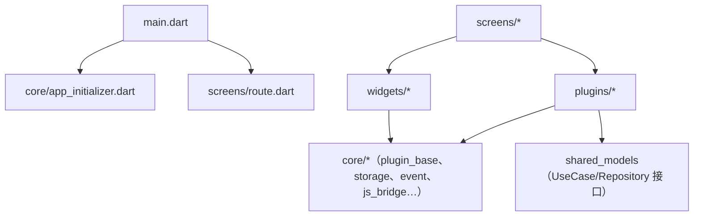

# 分层总览

> 所属：lib/ 应用代码层 · [返回索引](../CLAUDE.md)

## 四层结构

| 层 | 目录 | 规模 | 职责 |
|----|------|------|------|
| 核心层 | `core/` | 16 子目录 / 148 文件 | 平台无关的基础设施：插件系统、存储抽象、配置、事件总线、JS Bridge、悬浮球、动作系统、路由基础设施、各类服务 |
| 插件层 | `plugins/` | 25 插件 / 1056 文件 | 业务功能单元，每个插件自持 UI、Service、Controller，可向 JS Bridge/路由/数据选择器注册能力 |
| 界面层 | `screens/` | 17 子目录 / 350 文件 | 应用级页面（主页、设置、关于、日志、测试页）与**全部路由注册表**（`routing/routes/`） |
| 组件层 | `widgets/` | 17 子目录 / 180 文件 | 跨插件复用的通用组件：memento_editor（Quill 编辑器）、enhanced_calendar、form_fields、file_preview、data_selector_sheet 等 |

另有个位数文件的顶层目录：`services/`（image_service）、`models/`（file_path_converter）、`utils/`（9 个工具）、`dialogs/`、`constants/`、`l10n/`。

## 依赖方向

- `screens` 与 `plugins` 互相引用集中在路由层（`screens/routing/routes/*_routes.dart` 引插件页面；部分插件自带 `*_route_handler.dart`）。
- 插件不直接互相调用，跨插件通信走 `core/event/` 事件总线（文档 `docs/event.md`）。

## 插件形态

- 目录约定：`plugins/<name>/<name>_plugin.dart`（入口）+ `screens/`、`services/`、`widgets/`、`controllers/` 等子目录；根级公共基类 `plugins/base_plugin.dart` 与 `plugins/plugin_widget.dart`。
- 注册：`core/builtin_plugins.dart` 的 `_builders` 列表（25 项，顺序即装载顺序：chat → openai → agent_chat → diary → activity → checkin → contact → habits → database → timer → todo → day → tracker → store → nodes → notes → goods → bill → calendar → calendar_album → scripts_center → tts → nfc → webview → reminder）。
- 能力注册：JS API（`defineJSAPI`）、路由、数据选择器（供 AI/其他插件取数，见 `docs/PLUGIN_DATA_SELECTOR_GUIDE.md`）、桌面小组件数据。
