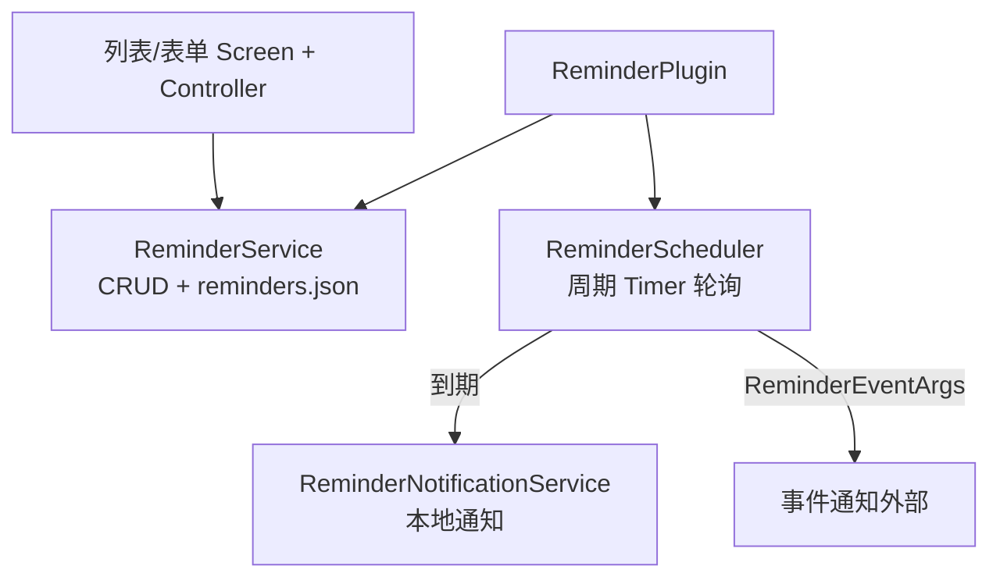

# 架构总览

> 所属：lib/plugins/reminder · [返回索引](../CLAUDE.md)

## 分层

## 生命周期

- `initialize()`：创建并初始化 `ReminderService`（从存储加载、恢复启用项调度），创建 `ReminderScheduler`。
- `registerToApp()`：启动调度器（`_scheduler.start()`）——调度开始晚于服务初始化。
- `buildMainView()` → `ReminderListScreen`；`buildCardView()` 显示"启用数/总数"统计卡片。

## 服务协作要点

- **ReminderScheduler**：周期检查 `nextTriggerAt` 到期的提醒 → 触发通知 → 按频率计算下一次时间；`start()` 时先 `_checkMissedReminders()` 补上应用不在线期间错过的提醒；提供 `triggerNow`（手动立即触发）与 `rescheduleAll`；触发时发出 `ReminderEventArgs` 事件。
- **ReminderService**：单例；增删改后持久化到 `reminders.json` 并同步刷新调度。
- **ReminderPushMethod** 中的 `fcm` 为占位实现，当前实际仅本地通知生效。

## 与其他模块的关系

- 通知最终经 `memento_notifications` 插件能力发送（由 ReminderNotificationService 封装）。
- 不在 `shared_models` 的 20 个共享域内，也不注册 JS API 与数据选择器——纯客户端本地插件。
