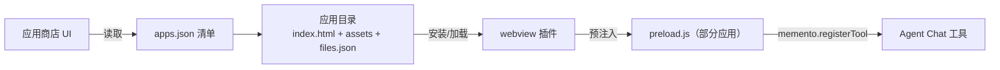

# 架构总览

> 所属：online/ · [返回索引](../CLAUDE.md)

## 两种内容形态

**Web 小程序（apps/）** —— 运行在 `lib/plugins/webview` 的 WebView 中：

- `files.json` 是文件清单 + 校验信息（由 `generate_files_json.py` 生成），用于安装完整性校验。
- `permissions` 字段声明所需能力（如 `storage`、`agent_chat`）。

**preload.js 工具注册（QuickJS 通道）**

- preload 脚本**不在 WebView 里跑**，而是由 Dart 侧在 QuickJS（flutter_js）引擎中执行。
- 脚本调用 `memento.registerTool({id, name, description, parameters[]})` 把小程序的能力注册为 Agent Chat 可直接调用的工具——AI 无需打开 WebView 页面即可使用（例如 password_manager 注册"保存密码"等工具）。
- Dart 侧执行前会验证 `memento.registerTool` 已存在，脚本无需等待逻辑。

**在线脚本（scripts/）** 与 **Agent 配置（agents.json）**

- 脚本同样是 JS（如 ai_encouragement_bot：监听活动事件 → AI 生成鼓励语 → toast 展示），按 `scripts.json` 分发。
- `agents.json`：`agents[]` 数组，每项含服务商（serviceProviderId/baseUrl/headers）、模型参数（model/temperature/topP…）、系统提示词 messages、图标与功能开关（enableFunctionCalling 等）。
