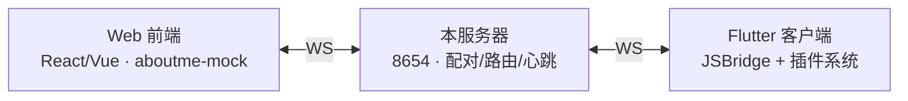

# 架构总览

> 所属：packages/api_forwarding_server · [返回索引](../CLAUDE.md)

## 三端角色与通信流

一次调用的路径：前端发请求 → 服务器按配对会话路由到客户端 → 客户端 JSBridge 执行插件 API → 响应原路返回前端。

## 源码结构（4 文件）

| 文件 | 职责 |
|------|------|
| `index.ts` | 启动 WebSocket 服务 |
| `server.ts` | 连接管理、配对密钥匹配、双向消息转发、心跳检测 |
| `session.ts` | 配对会话（前端 + 客户端两条连接的绑定）生命周期 |
| `types.ts` | 消息协议类型 |

## 设计取舍

- **无状态、无存储、无鉴权体系**：信任模型建立在"双方持有相同配对密钥"之上，适合个人自部署；公网部署需自行加反代鉴权。
- 只做转发不做业务：所有插件逻辑留在客户端，服务器不接触 Aboutme 数据模型。
