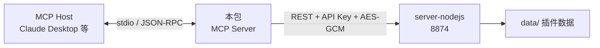

# 架构总览

> 所属：packages/mcp-memento-server · [返回索引](../CLAUDE.md)

## 分层

- **工具层**（`src/tools/index.ts`）：60+ 工具定义（名称、描述、JSON Schema 参数），按插件域分组注册。
- **客户端层**（`src/client/memento-client.ts`）：把工具调用翻译为 server-nodejs REST 请求（JWT/API Key 认证 + 加密载荷）。
- **配置层**（`src/config.ts`）：从 `.env` / 环境变量读取三要素。

## 12 个工具域

chat（频道与消息）、notes、activity（含今日统计）、goods（仓库与物品）、bill（账单与账户、统计）、todo（任务、完成/今日/过期）、diary、checkin、calendar、contact、tracker、day。

## 设计取舍

- 工具集是 server 19 个插件域的**子集**（12 个），只暴露对 AI 有意义的读/写操作。
- stdio 传输（本地进程）而非 HTTP，适配桌面 MCP Host；服务器与数据全部外部化，本包可随时重启无状态。
