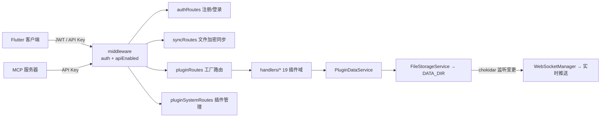

# 架构总览

> 所属：packages/server-nodejs · [返回索引](../CLAUDE.md)

## 技术形态

- Express 4 + express-ws/ws，TypeScript 5.5 编译到 `dist/`，Node ≥ 18。
- **无数据库**：`FileStorageService` 管理纯文件存储（`DATA_DIR`），数据可整目录备份，支持 ZIP 导出（adm-zip / archiver）。
- 管理面板 `admin-vue/`（Vue ^3.5 + naive-ui + pinia + Vite ^8）单独构建，静态产物由服务器托管于 `/admin`。

## 请求流

## 服务清单（`src/services/`）

| 服务 | 职责 |
|------|------|
| `fileStorageService.ts` | 文件存取基座，data 目录初始化 |
| `authService.ts` | 用户、JWT 签发/校验、API Key |
| `encryptionService.ts` | AES-256-GCM 端到端加密（与客户端 `encrypt` 对应） |
| `pluginDataService.ts` | 插件数据读写（19 域） |
| `pluginService.ts` | 服务端插件：安装（ZIP/商店）、启用/禁用/卸载、生命周期 |
| `webSocketManager.ts` | WebSocket 连接管理与实时推送 |
| `fileWatcherService.ts` | chokidar 监听 data 目录变更 → 推送 |
| `fcmService.ts` | firebase-admin 推送 |
| `eventEmitter.ts` | 服务内事件 + hookable 钩子触发点 |

## 设计取舍

- 路由用**工厂模式**（`pluginRoutes/factory.ts` + `routeConfig.ts`）：新增插件域只需 handler + 注册，不必写路由样板。
- 认证双轨：交互用户走 JWT（默认 36500 天有效期），程序化访问（MCP/第三方）走 `mk_live_` API Key，`apiEnabledMiddleware` 控制接口开关。
- 服务端插件系统与客户端插件系统相互独立：前者是可热装的数据处理扩展（钩子），后者是 Flutter 功能模块。
