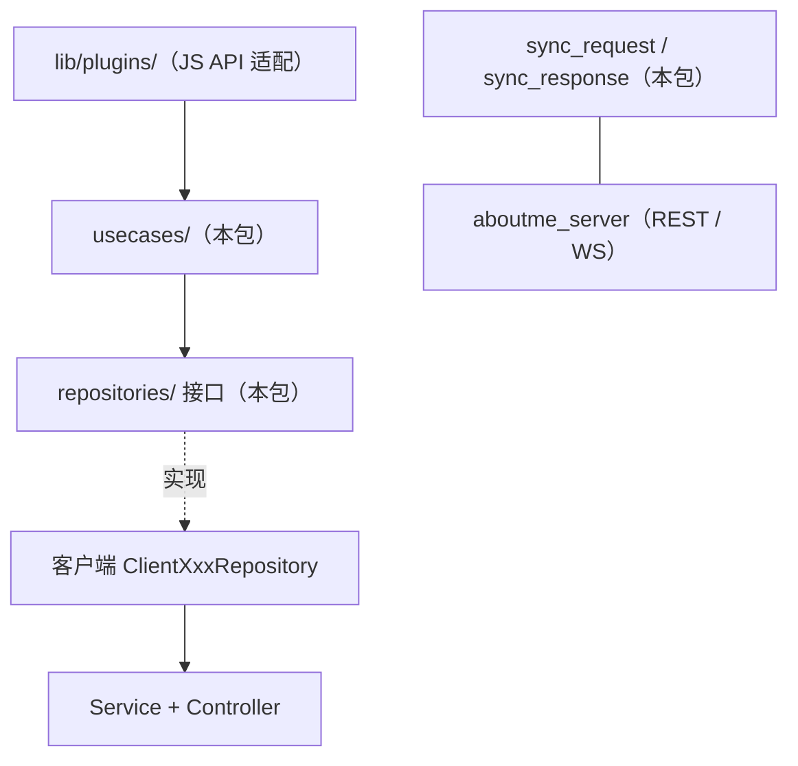

# 架构总览

> 所属：shared_models · [返回索引](../CLAUDE.md)

## 定位

纯 Dart 包，作为客户端（Flutter）与服务端逻辑之间的**契约层**，不依赖 Flutter。三层内容：

| 层 | 目录 | 数量 | 说明 |
|----|------|------|------|
| Repository 接口 | `lib/repositories/<plugin>/` | 20 域 | 每插件一个抽象接口（CRUD/查询），客户端以 `ClientXxxRepository` 实现 |
| UseCase | `lib/usecases/<plugin>/` | 20 域 | 包装业务用例，插件层直接调用 |
| 协议与工具 | `lib/sync/`、`lib/auth/`、`lib/utils/` | 7 文件 | 同步请求/响应、认证、分页/校验/Result/MD5 |

## 覆盖的 20 个插件域

activity、agent_chat、bill、calendar、calendar_album、chat、checkin、contact、database、day、diary、goods、habits、nodes、notes、openai、store、timer、todo、tracker。

（客户端共 25 个插件——nfc、scripts_center、tts、webview、reminder 暂无共享模型，属客户端本地插件。）

## 在整体架构中的位置

## 依赖

`json_annotation`（序列化注解）、`crypto`（MD5）、`uuid`；dev：`json_serializable` + `build_runner`、`lints ^4`。SDK：`>=3.0.0 <4.0.0`。
